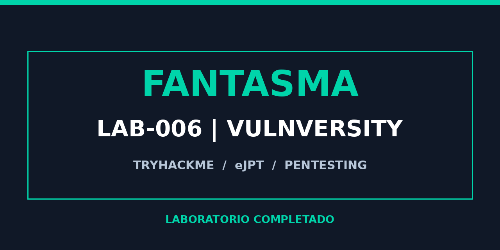

# LAB-006-VULNVERSITY | TryHackMe

**Autor:** FANTASMA  
**Plataforma:** TryHackMe  
**Objetivo:** Formación práctica eJPT  
**Estado:** Completado

## Resumen ejecutivo

Evaluación de seguridad de la máquina Vulnversity en un entorno autorizado de TryHackMe.

Se identificó una vulnerabilidad en el formulario de subida de archivos que permitió ejecutar código PHP como `www-data`. Posteriormente, una configuración insegura del permiso SUID en `systemctl` permitió elevar privilegios hasta root.

## Reconocimiento

Se realizó un escaneo de puertos TCP con Nmap.

- 21/TCP: FTP
- 22/TCP: SSH
- 139/TCP: NetBIOS
- 445/TCP: SMB
- 3128/TCP: Squid Proxy 4.10
- 3333/TCP: Apache HTTP Server

Evidencia: [Nmap](01-Reconocimiento/nmap-inicial.txt)

## Enumeración web

Mediante enumeración web se identificó el directorio `/internal/`, que contenía un formulario de subida de archivos.

Evidencia: [Gobuster](02-Enumeracion-Web/gobuster-inicial.txt)

## Explotación

El formulario restringía la subida de archivos `.php`, pero aceptaba la extensión `.phtml`.

Se confirmó ejecución de código PHP y acceso remoto con los permisos del usuario `www-data`.

## Escalada de privilegios

La enumeración SUID identificó el ejecutable `/bin/systemctl`, propiedad de root.

Se verificó que podía iniciar servicios con privilegios elevados. Posteriormente se obtuvo una sesión con `euid=0(root)`.

## Resultados

| Objetivo | Resultado |
|---|---|
| Reconocimiento | Completado |
| Enumeración web | Completado |
| Ejecución remota de comandos | Confirmada |
| Acceso como www-data | Confirmado |
| Escalada a root | Confirmada |
| Root Flag | Conseguida |

Las flags y los archivos de explotación no se publican.

## Recomendaciones de seguridad

1. Validar extensiones, contenido y tipos de archivos en el servidor.
2. Impedir la ejecución de scripts en directorios de subida.
3. Aplicar el principio de mínimo privilegio.
4. Eliminar permisos SUID innecesarios de herramientas administrativas.
5. Auditar configuraciones y monitorizar eventos de seguridad.

## Referencias

- [TryHackMe — Vulnversity](https://tryhackme.com/room/vulnversity)
- [GTFOBins — systemctl](https://gtfobins.github.io/gtfobins/systemctl/)

---

**FANTASMA | Ethical Hacking & Pentesting**

*Práctica realizada exclusivamente en un entorno de laboratorio autorizado.*
